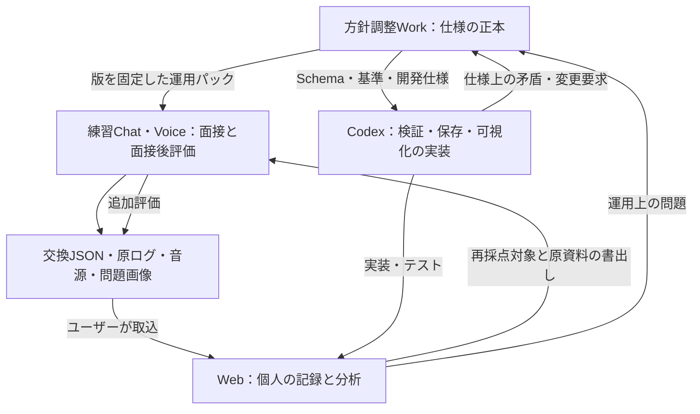

# 英検準1級 Voice面接対策システム — 設計・運用仕様 v1.0.0

設計日：2026-10-27（日本時間）。状態：推奨初版。以前の設計・38点方式・項目名は継承せず設計した。これは学習支援システムであり、英検公式採点システムの再現ではない。ユーザーによる採用前の仕様を「ユーザー承認済み」と記録しない。

この文書は、①決定事項の洗い出し→②選択肢→③推奨案→④データフロー→⑤実行可能な仕様の順に読む。実際のWebサイトは今回実装していない。Schema・分類辞書・評価基準・引継ぎプロンプトを同梱する。

## ① 決定すべき項目の洗い出し

| 分野 | 決める項目 | 未決定だと起こる問題 |
|---|---|---|
| 責任分担 | Work / Chat・Voice / Codexの権限、変更手順、正本 | 会話の途中で基準が変わる |
| 試験プロファイル | 従来型準1級を対象にするか、公式事実と学習上の設定の区別 | 他級・S-CBTの手順が混ざる |
| 問題 | 4コマ画像の調達、カードの版、Q1〜Q4、見たことがある問題の扱い | 読解練習や暗記を実力向上と誤認する |
| 練習方式 | 模擬面接、部分練習、指導付き、やり直し | 異なる条件の点数が混ざる |
| 時間・進行 | 準備1分、ナレーション2分、計時担当、発話終了・中断 | Voiceが正確に時間を測ったことにされる |
| 収録 | 画面の会話記録、音声、画像、イベント、欠落の記録 | 発音を将来検証できない |
| Transcript | 原文、逐語性、話者、順序、言い直し、不明箇所、修正履歴 | 正しい英文に直された文を原発話として保存する |
| 採点 | 観点、尺度、アンカー、根拠、未評価、集計、音声の証拠 | 取得できない能力を数値で埋める |
| 分析 | Mistake / Strength / Topic / Question、重大度、重複単位 | 回数比較が無意味になる |
| データ | ID、RAWと解釈、Schema、参照、null、日時、文字位置 | インポートや再採点が壊れる |
| 変更管理 | 仕様・プロンプト・基準・辞書・入力・モデルの版 | 成長と採点モデルの変化を区別できない |
| 品質管理 | 構造検証、意味検証、原文照合、人による訂正 | 正しいJSONでも事実が間違う |
| Web | 画面、指標、フィルタ、保存、バックアップ、端末間移動 | 見やすいだけで継続利用できない |
| 再解析 | 入力スナップショット、旧評価保持、比較対象、移行 | 過去の結果を上書きする |
| 運用 | 1回の流れ、失敗時、レビュー、変更要求の戻し先 | 毎回の操作が重くなる |

## ② 重要な設計上の選択肢

| 論点 | 選択肢 | 選ぶ案 |
|---|---|---|
| 環境の統合 | 全部1チャット / 3環境を分ける | 3環境。Workが唯一の方針決定窓口 |
| 会話の寿命 | 永続1チャット / 1面接1チャット | 1面接1チャット。同一チャット内で面接後処理のみ行う |
| 採点の目的 | 本番点の推定 / 学習用の根拠付き評価 | 後者。CSE換算・合格確率を出さない |
| 総合点 | 38点 / 独自100点 / 能力別表示 | 7能力のプロフィールを主役にし、文章・音声の指数を分ける |
| 収録水準 | 表示Transcriptのみ / 外部音声も保存 / APIで計測 | まずChatGPTで運用。音声も保存できる場合に再検証範囲を広げる |
| 完全性の約束 | プロンプトだけで完全保証 / 完全性を証拠で判定 | 後者。音源なしの完全逐語保証は要件として未達と表示する |
| 問題提示 | 画像 / 文章による場面説明 / 音声説明 | 模擬面接は画像必須。文章・音声説明は別の練習モード |
| データ単位 | 1巨大ファイルを毎回書き換える / 1面接ごとの交換パッケージ | 後者。保存先では追記型に正規化 |
| 評価更新 | 上書き / 新しい評価を追加 | 追加。基準変更とTranscript訂正は別の変更 |
| 初期Web | AI/API連携あり / JSONを手動取込する静的アプリ | 後者。APIの契約・録音アプリ・自動同期は初版に含めない |

## ③ 推奨案と理由

### A. 公式事実を固定し、学習上の判断を分離する

2026-10-27に公式ページを確認した。参照元は末尾に記載する。

* 従来型準1級二次は面接委員1人との英語面接で、約8分。簡単な日常会話、4コマの展開を説明するナレーション、4問の応答がある。[S1, S2]
* ナレーションの準備は1分、発話は2分。カードにある言い出しを使う。2分を超えれば途中でも終了する。[S2, S3]
* Q1ではカードを見てよく、その後カードを裏返す。Q2・Q3はカードのトピックに関連、Q4はやや関連する社会的な内容という公式の構成を採る。Q1の人物の立場で考えを述べる形式は公式サンプルに見られる。[S1, S2, S4]
* 自然な聞き返しは一律の減点対象ではない。繰り返し・不自然さや応答停止とは区別する。[S2]
* 公式が挙げる観点には内容、発音、語彙、文法・語法、情報量、意思疎通への意欲・態度などがある。細かな点数別アンカーまでは今回確認した資料では確定できない。[S2]
* 準1級Speakingは750点満点、二次の合格基準はCSE 512。CSEを自分の正答数から計算できない旨も公式説明にある。AI点や正答率を線形換算しない。[S5, S6]

「ナレーション15＋4問×5＋態度3＝38」は、今回確認した公式資料では裏付けられなかった。誤りと断定するのではなく、正式な採点実装の根拠として不足するため採用しない。後に確認できても独自学習尺度を上書きせず、別profileとして検討する。

### B. 生データを残し、解釈を積み上げる

音源・元の会話ログ・問題画像が再解析の材料。Transcriptはそれらから得られる表現で、採点はさらにその解釈である。音源を残さず、AIが面接後に再構成した文章だけを保存しても、元の声や脱落語は復元できない。

したがって、原資料・Transcript各版・評価各回を別IDで保持する。既存データを直すのではなく、新版と旧版の関係を残す。音声ファイルのSHA-256も取得ツールが計算し、AIに架空のハッシュを埋めさせない。

### C. できない観測は数値にしない

ChatGPTの通常のVoiceを使うことと、APIの音声イベント・時間計測を使うことは別である。公式のAPI資料にはTranscriptイベントがあるが、その機能がこのChatのエクスポートで使えるとは仮定しない。[S7, S8]

発音・間・抑揚・正確な発話時間は、Transcriptだけからは評価しない。Voice中に聞けた印象は保存できても、後から音源が読めないなら暫定観察とする。文法誤りに見えてもASRの取り違えが疑われるときは uncertain として扱う。

### D. 運用を軽くする

ユーザーは毎回、専用Chatを作る→練習→テキストで面接後処理→JSONを保存→Webへ取込する。全件の手動確認を毎回要求しない。欠落や不確かな箇所だけ確認する。録音を使う日は、練習前に自分とAIの両方の声が録れるか短い試験を行う。

## ④ 3環境間のデータフロー

矢印は受け渡す内容を示し、自動連携の保証ではない。初版は手動のファイル受渡し。Workは全音源・全履歴を常に読み込む必要はなく、問題があったデータだけ参照する。CodexはUIやアルゴリズムを実装するが、ユーザーの英語を採点したり、新しい採点方針を制定したりしない。

| 渡す元→先 | 正式な受渡物 | 渡さなくてよいもの |
|---|---|---|
| Work→Voice | Voiceプロンプト、rubric、taxonomy、protocol、Schema、開始チケット、問題素材 | 開発履歴・画面設計・リポジトリ事情 |
| Work→Codex | 本文、開発仕様、Schema、profiles、合成例、検証コード、release manifest | 実際の面接の相手役 |
| Voice→Web | 1面接のJSONと必要な原資料 | Workでの仕様議論 |
| Web→Voice | 再採点用の原資料＋指定版の基準。旧点は既定で隠す | サイトのソースコード |
| Codex/Voice→Work | 矛盾の例、影響、変更案。実施した逸脱の記録 | 勝手に反映した新仕様 |

## ⑤ 最終仕様（推奨初版）

### 5.1 環境の責任と変更管理

Workが仕様・基準・分類辞書・運用プロンプト・開発契約の正本を管理する。Chatは配布された版を実施し、Codexはその版を実装する。実装上の選択（コンポーネント分割など）はCodexで決めてよいが、採点尺度・欠損の意味・集計条件を変えてはならない。

変更は、Workで変更理由→影響対象→移行方法→新しいreleaseを作成→両環境へ配布。過去のreleaseファイルは消さない。練習中のセッションは開始時の版を維持する。緊急中断・接続障害は可能だが、裏で基準を切り替えない。

版を独立に付ける対象：system spec、exchange schema、exam protocol、rubric、taxonomy、Voice prompt、post-interview prompt、evaluator prompt、metric definitions、Web app、migration。版番号だけでなく実ファイルも保存する。モデル名は画面表示のreported値と、取得できた厳密なmodel_idを分ける。分からなければnull。Voiceの実行モデルをWorkで選んだモデル名から推定しない。

### 5.2 練習モードと出題

| mode | 目的 | 指導・やり直し | 成長グラフ |
|---|---|---|---|
| mock_interview | 従来型の流れに沿う通し面接 | 面接中は指導しない | 同条件の初回attemptだけを既定表示 |
| focused_drill | ナレーションや特定質問の練習 | セット後に指導可 | 別系列 |
| coached_practice | ヒント・途中訂正を使う | 許可、イベントに記録 | 模擬と混ぜない |
| text_scenario_drill | 画像なしの場面説明を使う | 条件を記録 | 別系列 |
| retry | 同じ問題で再回答 | 前の回答をparent_session_idで参照 | 別系列・初回と対で比較 |

模擬は、内容を確認済みの4コマ画像、指示、開始文、Q1〜Q4を準備する。画像生成・画像の精査・難度設計はWorkで行い、Voiceが毎回その場で画像を生成することは前提にしない。公式サンプル・市販問題・自作問題の出典と利用範囲を記録する。公式画像や市販教材を公開GitHubのサンプルに入れない。

出題セットの本文は面接開始前に固定する。解答例・採点ポイントをユーザーに先に表示しない。Q1は人物の立場で考えを述べる練習を基本にし、Q2・Q3は関連トピック、Q4はやや関連する社会問題へ展開させる。TopicとQuestionのタグはセット本文からの分析であり、回答の良し悪しとは切り離す。

Voice中の待機・自然な発話終了・途中での割込み抑制はプロンプトで努力できるが、完全制御を約束しない。1分・2分の正確な計時は外部タイマーを基本にする。タイマー信号による発話・操作は練習上の操作として記録する。応答終了の合図は必要な端末だけ「That's all.」等を使い、実発話として残すが答案の内容・語数には含めない。Q&Aに「公式30秒」等の未確認の制限を設けない。目安を設けたときは学習設定と明示する。約8分は試験全体の目安で、合計が必ず480秒になるよう調整しない。

状態遷移は setup→warmup→preparation→narration→q1→card_hidden→q2→q3→q4→closing→post_processing。未実施・中止も保存する。カードを裏返す操作はユーザー担当。Voiceが画面を自動で隠すと約束しない。

### 5.3 完全なTranscriptの定義と取得水準

目標は「AIと本人の発話を省略・文法修正せず、順序と話者を保存すること」。しかし完全性を3軸に分ける。

| 軸 | 判定の例 |
|---|---|
| 範囲 coverage | 画面上の全ターンを収録 / 一部欠落 / 不明 |
| 逐語性 fidelity | UI表示 / ASR逐語 / 人が音源照合済み / 記憶からの再構成 |
| 再検証可能性 | 原音声あり / 元ログのみ / その場の観察のみ |

「全ターンあり」は「実際の発話と一字一句同じ」を意味しない。`coverage=complete`だけで完全逐語と表示しない。人が全音源と照合した版が human_verified。聞き取れない語が残ればtextに推測で埋めず、unintelligibleのターンや欠落メモを使う。

取得レベルT：Chatの表示・書き出せる会話ログをそのまま保存する。全英文の両話者・順序を残す。画面上にないフィラー、繰り返し、秒数は足さない。元の表示ログをcapturesとして保存できなかった場合、JSON中のTranscriptは再構成であることを明示する。この水準の再解析は文章中心。

取得レベルA：Tに加え、自分とAIの両方を収録した原音声を別ファイルで保存する。片方の声しかない・途中欠落・録音方法が不明ならその通り記録する。APIや端末録音の利用可否は実機で確認する。音源があれば再ASR・発音・流暢さの再評価が可能になるが、録れていない情報は後から作れない。

APIを使う自作収録システムは将来の別機能。通常のChatGPT VoiceにAPIのイベントID・発話時刻があると仮定しない。初版のWebは収録環境ではなく保存・分析環境。厳密な「実発話の完全保存」を必須にする運用はレベルA＋全音源照合を採用条件とし、レベルTでは要件未達の項目を表示する。

各ターンに話者、順序、phase、question_id、原文、取得元を付ける。挨拶、聞き返し、AIの言い間違い、日本語、接続トラブル、制御発話も残す。得点計算では答案に該当するターンだけを選ぶ。grammarの訂正はrewritesに保存し、Transcriptに書き戻さない。新しいTranscriptを作る場合はparent_transcript_idとprevious_turn_idsで系譜を残す。曖昧な語をユーザーに確認しても、元のUI表記は消さない。

turn_kindはanswer / question / social / control / other。タイマー通知や発話終了合図はcontrolとして原文を残し、答案語数には含めない。1つの発話に答案と制御が混ざった場合、同じ取得元を参照する別ターンへ分け、その分割をnotesへ明示する。元ログは分割せず保持する。

### 5.4 RAW・派生データ・評価の分離

| 層 | 配列・オブジェクト | 内容 | 変更方法 |
|---|---|---|---|
| 原資料 | assets / captures | 音源、画像、元のログ、計測元、観察記録 | 同じIDのバイト・本文を上書きしない |
| 面接条件 | session / question_sets / events | モード、セット本文、障害、援助、タイマー | 訂正は履歴・新exportとして明示 |
| Transcript | transcripts | 表示文・ASR・確認済みの各版 | 新版を追加 |
| AI評価 | assessments | 採点、ミス、強み、分類、助言、修正版 | 新assessment_idを追加 |
| 人の判断 | annotations | 異議、確認、既定評価の選択 | 追記 |
| Web派生 | アプリ内の計算結果 | 指数、語数、集計、グラフ | 正本から再計算可能にする |

モデルが作る解釈をRAWと呼ばない。`model_reconstruction`と`live_observation`は取得元を表す分類であり、原音声と同じ証拠能力を持たない。AIによる音声印象のメモはlive_observationに置けるが、誤り認定・点数はassessmentに置く。

### 5.5 採点ルーブリック

7観点を各0〜4の整数で評価する。正式な点数別アンカーは02-rubric.mdとprofiles/rubric.json。公式の点数・CEFR換算とは別の学習尺度である。

| ID | 観点 | 主な根拠 | 単位 |
|---|---|---|---|
| task_response | 質問への適合・必要な内容 | 質問、画像、回答 | 5課題それぞれ |
| organization | 展開・構成・つながり | 回答の順序、因果、指示関係 | 5課題それぞれ |
| grammar | 文法・語法の正確さと使用範囲 | 確かな原文 | 5課題それぞれ |
| vocabulary | 語彙の適切さと柔軟性 | 原文・文脈 | 5課題それぞれ |
| intelligibility | 音声の理解しやすさ | 実際に聞いた音声 | 5課題それぞれ |
| fluency | 発話の継続・間・修復 | 実際に聞いた音声 | 5課題それぞれ |
| interaction | 応答・聞き返し・会話の維持 | 双方のやりとり・イベント | セッション |

共通の意味は0＝観測された遂行が成立しない、1＝大きな困難、2＝部分的に成立、3＝おおむね成立、4＝安定して効果的。4を「ネイティブ同等」としない。アクセントの種類、政治的立場、知識量、長さ自体を加点減点しない。長いだけの回答・難語の詰め込みを高評価にしない。

`scored`のみscoreが数値。`not_assessable`（証拠不足）、`not_applicable`（対象外）はnull＋理由。欠落・音源なしを0で埋めない。無回答が観測された場合、task_response=0にできるが、語彙・文法はサンプル不足なので未評価。Transcript欠落は無回答ではない。文法・語彙は少なくとも学習内容の英語5語を観測できない場合、初版ではinsufficient_sampleとする。5語は公式基準ではなく、短すぎるサンプルの過大解釈を避ける運用上の下限。

ナレーションのtask_responseは4コマの主要な出来事・変化・結末の伝達。organizationは時系列・因果・人物の明確さ。Q1は指定人物の立場と状況への整合性。Q2〜Q4は直接の回答、理由・具体化・筋の通った説明を評価し、理由を必ず2つ要求する等の固定型は採用しない。

各点に根拠refと短い理由を付ける。引用はその版の原文に一致させる。文法を直した引用や、実在しない発話を根拠にしない。confidenceはAIの証拠の確かさ（high/medium/low）であり統計的確率ではない。自己修正を誤り2件に数えない。1つの原因を複数観点で説明できるが、点は各観点の遂行アンカーで決め、ミス件数から機械減点しない。

### 5.6 指数と比較可能性

主画面は7観点と課題別結果。補助指数は以下の2つで、合算しない。

* 文章指数：各課題のtask_response / organization / grammar / vocabulary平均÷4×100。
* 音声指数：各課題のintelligibility / fluency平均÷4×100。
* セッション値：ナレーション40%、Q1〜Q4は各15%で課題の指数を加重平均。これは本システムの便宜的な初期重みであり、公式配点ではない。
* 対象となる全課題・全観点がscoredでなければ、そのセッション指数はnull。観測済みだけを再加重して「全体点」にしない。課題別結果とcoverageは表示できる。
* `live_audio`に依存する音声指数はprovisionalとして別表示し、archived_audioの指数と同一系列にしない。音源ファイルがあっても、当該採点者が実際に利用していなければarchived_audioにしない。
* interactionは独立表示。文字だけのやりとりでは応答・聞き返し等の限られた範囲を評価できるが、声・表情・視線を含む総合的態度とは表示しない。

比較キーはrubric version＋evaluator prompt version＋taxonomy/metrics version＋model identity/knownness＋mode＋証拠モード＋問題の既見条件。モデル不明同士を同じモデルと仮定しない。厳密な同条件比較として扱えない場合は注記する。日付はセッション開始日をAsia/Tokyoで扱い、不明なら日付無しに分ける。週は月曜始まり。欠測に点や線を補わない。

成長の既定は未見の問題・通し模擬・初回・無援助。基準やモデルを変えたら線を分けるか、共通の新基準で同じ過去データ群を一括再採点して比較する。問題難度・トピックの影響は残るため、グラフの差をすべて能力の変化とは解釈しない。難度はAIラベルを記録できるが初版では等化しない。合格確率・CSE予測・偏差値は出さない。

### 5.7 Taxonomy

profiles/taxonomy.jsonに固定ID・日本語ラベル・定義・必要証拠・集計単位を収録。Mistake / Strength / Topic / Questionは独立辞書。Topicは複数付与、Questionのslotと認知的要求も分ける。辞書にない概念はcandidateとして説明欄に残し、既存IDの意味を流用しない。

Mistakeは文法、語彙、内容、構成、発音、流暢さ、対話に分類する。Strengthはミスの単なる反転ではなく、具体的に再利用できる成功を記録する。`uncertain`と`style_suggestion`をmistakeに数えない。1発生箇所はoccurrence_group_idで束ね、主taxonomy_idを1つ、補助タグを複数にする。taxonomyは分類ラベルであり根本原因の証明ではない。緊張・知識不足等の原因推測はroot_cause_hypothesisへ分ける。

ミス頻度は「回答あたりの出現率」「100語あたりの確かな文章ミス」を分ける。回答・語数の分母、対象範囲、辞書版、除外件数を表示する。発音ミスを文字語数で正規化しない。特定文法の使用機会を数えられないとき、冠詞の誤り件数から冠詞正確率を作らない。強みなしの配列は能力がないことを意味しない。

### 5.8 音声特有情報

保存できるもの：録音範囲、チャンネル、収録ツール、長さ、サンプリング周波数、話者分離状況、原ファイルhash、発話区間、応答開始遅延、無音、フィラー、言い直し、割込み、音量・雑音の問題。取得していないものはnullまたは未記録とする。

metricsの初期定義：duration_msは音源区間の終端−始端、wpmは当該回答の計数可能な語数÷発話区間分（区間内の無音を含む）、long_pause_countは区間内500ms以上の無声区間、response_latency_msは面接官質問の音声終了→受験者の音声開始。休止の検出器・閾値・版を必須にする。通信遅延を考慮できない場合はresponse_latencyを能力指標にしない。調音速度（無音除外）や音素別エラー率は初版では実装しない。Transcriptの句読点から無音やイントネーションを作らない。

初版のWebは文字語数以外の計測を勝手に生成しない。数値を取り込む際は根拠assetとmeasurement methodを検証する。Voiceの体感「少し長い間」は定性的な観察として残し、500ms等の数値へ変換しない。

### 5.9 JSONデータモデル・Schema

1回の交換単位は`eiken_pre1_session_bundle`。schemas/session-bundle.schema.jsonはJSON Schema Draft 2020-12の正式な構造契約。API Structured Outputsにそのまま全量が使えるとは仮定せず、API導入時は対応するサブセットへ変換し、最終的に正本Schemaと意味検証を通す。[S9, S10]

`bundle_mode=self_contained`は原資料・問題・Transcriptを含み、そのファイル内で参照が解決する。`append`はsession情報を保持したまま追加評価等だけを運べるが、参照先の既存データが必須。appendを単独で完全バックアップと表示しない。長い出力は先に原資料のself_contained bundle、次にassessmentのappend bundleとして分割でき、両方の取込で初めて揃う。

| 主なキー | 役割 |
|---|---|
| schema_version / export_id / release | 構造版、交換ID、使用release |
| session | 面接ID・条件・モード・初回/再回答・日時・合成例フラグ |
| assets / captures | 原ファイル参照と取得元本文 |
| question_sets | 固定された問題セットの本文と出典 |
| transcripts / events | 各版の発話と進行・障害記録 |
| assessments | 入力を固定した各評価、採点・分類・修正版・助言 |
| annotations | 本人の確認・異議・既定版の指定 |

IDは一度保存したら不変。面接IDは開始チケットでWorkまたはWebが発行することを推奨する。VoiceがIDを作る場合も同じ会話中で一貫させ、取込時の衝突を確認する。AIに実行していないUUID生成・時刻取得・hash計算をしたと言わせない。created_at等を知らなければnull。imported_atはWebが実時計から別途保存する。内容と生成日時を混同しない。

question_set_idは問題セットの特定の版を識別するID。問題本文や画像を変更した版には新しいquestion_set_idとversionを付ける。transcript_idも各版固有。Transcriptを修正するときは変更しないターンも含め新版で新turn_idを発行し、previous_turn_idsで旧版を参照する。再採点のみなら既存のTranscript・turn IDをそのまま使う。

配列の[]は「記録された要素がない」、nullは「不明・未取得・対象外」で、理由は対応するstatus/reasonに残す。0は観測されたゼロのみ。Schemaで許可していないフィールドは黙って消さずエラーにする。全オブジェクトは追加キーを禁止する。後から拡張する場合は新schema版とmigrationを用意する。

evidenceの文字位置はUnicodeコードポイント単位・0始まり・終端を含まない。JavaScriptのUTF-16インデックスと混同せずArray.from(text)で扱う。原文を正規化してから照合しない。引用一致と位置一致を検証する。ファイルhashは元bytesにSHA-256。論理JSONのhashを作るときは正規化規約を別版で固定し、単なるJSON.stringifyを標準的な正準化と称さない。

### 5.10 再採点と訂正

再採点手順：対象session→Transcript版と問題セット・音源を選択→採点基準とevaluator promptを指定→入力スナップショットを作成→既存の点・講評を除いてVoice専用Chatへ渡す→新assessmentを追記→入力差・基準差・モデル差を表示。

同じ入力＋同じ基準でもAI採点は必ず同点になるとは限らない。再解析可能性は「同じ結果の完全再現」を保証しない。基準変更の評価、Transcript修正版の評価、同条件の再実行を区別する。過去の評価は削除・上書きしない。supersedes_assessment_idは関連を示すだけで既定表示を勝手に切り替えない。

再採点時に旧点が見えた場合、blind_to_prior_scores=falseにする。過去に保存していない発音・間は再採点でも未評価。旧taxonomyは元のID・定義を残し、新版へのmappingは別の変換表を追加する。1対多の曖昧な対応を自動で一意に割り当てない。

### 5.11 データ検証と取込

検証は4段階に分ける。1) JSON構文・サイズ、2) Schemaの型・enum・必須・範囲、3) ID参照・引用・時間順・分類・採点根拠・版等の意味検証、4) 元資料と発話・評価の事実照合。Schema合格は発話や採点の正しさの証明ではない。

エラーは取込を確定せず、ファイルと位置・理由を表示する。Warningは不足・不明モデル・音源未添付等。原JSONは隔離領域に保持し、修正版は別に受け取る。部分的に使えるTranscriptのある未完了面接は保存できるが、全体点や模擬回数には加えない。

インポートは検証→差分プレビュー→確定のトランザクション。export_id＋元ファイルhashの一致は同一取込として再追加しない。同じsession_id・同じ内部IDの同内容は再利用。同じIDで別内容は衝突として止める。似た内容でもIDが違う面接は重複候補の表示に留め、勝手に削除しない。appendされたassessmentは既存面接へ追加できる。参照はファイル内またはローカルDBに存在する必要があり、未解決参照を黙って落とさない。

不明なschema major版は読み取り用の隔離表示。旧版移行はdry run→新形式のコピー生成→検証→保存、元は残す。新旧差分とmigration版を記録する。削除はユーザーの操作で行い、原文・音源・評価・キャッシュを含む削除範囲を表示する。追記原則はユーザーの削除権を妨げない。

### 5.12 Voice専用Chatの運用

prompts/voice-chat.mdを新Chatの最初に渡し、profilesとSchemaを添付する。1面接1Chatで、面接中は英語のみ・1問ずつ・助言なし。セットとカードの参照可能性を確認し、不足ならその事実を述べ、模擬を開始しない。画像なしモードへの切替は本人が選んだときだけ行う。

面接終了後は音声を停止し、同じChatのテキストでprompts/post-interview.mdを実行する。面接後の評価・JSON生成はこのChatの責務で、開発・仕様変更の議論は行わない。まず原文の全ターンを保存し、取得範囲と不明箇所を確認。次に採点・分析。最後に正本Schemaに沿う1つのJSONを出力する。長ければ原資料JSONと追加評価JSONを別exportとして出力してよいが、途中で切れたJSONや断片を正式取込しない。

JSON生成は通常Chatではスキーマ適合を強制保証できるものではない。自己点検に加えWebの検証を必須にする。JSONを音声で読み上げない。原文を再構成した場合はreconstructionとし、元ログを取得したことにしない。発音を聞き取れた印象だけから確定的な音素誤りを作らない。

### 5.13 Web・Codexへの開発契約

詳細は03-codex-development.mdとprompts/codex.md。初版は個人用の静的Webアプリ、TypeScript＋React＋Vite、ブラウザ内IndexedDB、JSON/素材の取込と書出し。依存の正確な版は実装時に公式資料を確認してlockfileへ固定する。分析は端末内で行い、音声や原文を公開リポジトリへ入れない。

Dashboardは直近の練習、課題別得点、7観点、評価可能範囲、今の重点3件。履歴は条件・問題・版で絞込。面接詳細はAIと本人の全文、証拠、音声があれば区間再生、修正版を並べる。比較は同じ面接の再評価と別日の実力推移を区別する。弱点ページは根拠付きミスと強み・トピックの偏り・再発を示す。データ管理は警告、参照切れ、バックアップ、取り込み履歴を扱う。

スマホで主要結果を短い画面内にまとめ、落ち着いた配色・小さめでも読める文字・高密度で整理された表示を使う。マイク操作やAI面接官をサイトに勝手に実装しない。Codexが採点方針を決めずに済むよう、集計関数の入力・出力・null条件を固定する。

端末内保存は端末間同期ではない。iPhone/PC間は書出し・取込で移す。ブラウザの保存領域は唯一のバックアップにしない。JSONだけのバックアップと、音源・問題画像込みのバックアップを区別する。大きい音源は初期段階ではJSON外で保持でき、欠落ファイルがあっても文章記録を読める。外部参照URLが将来も使えると保証しない。

### 5.14 導入・検証の順番と完了条件

1. 合成例でSchema・意味検証・参照・null処理を確認する。
2. 実機で短い試験会話を行い、両話者のTranscript範囲、カード参照、タイマー操作、録音するなら両音声の再生を確認する。成功していない機能は「利用可能」にしない。
3. 1回の模擬面接を保存→取込→全文・点数・欠測表示→書出しを確認する。
4. その同じ面接を、旧点を見せずに再採点し、2つの評価が残ることを確認する。
5. Transcriptの1箇所を新版で訂正し、旧評価の参照先が変わらないことを確認する。
6. 以上の後に通常運用へ移る。モデル変更は、個人運用上の初期チェックとして5〜10件程度の共通記録を両方で評価し、観点別のずれを点検する。この件数で統計的な等化・精度保証が成立するとは主張しない。

仕様が完成していることと、Voiceで完全保存・Web実装が実機確認済みであることは別。現時点で残る実機依存項目は、使用端末での会話ログ取得方法、両話者音声の収録方法、画像を参照したVoiceの進行、タイマー連携。これらは試運転で確かめ、失敗時は取得水準を下げて記録する。設計項目をその場で変えない。

### 5.15 同梱ファイルの正本関係

* 本文：全体の規範。採点の個別アンカーは02-rubric.md / profiles/rubric.json。
* schemas/session-bundle.schema.json：構造の正本。
* profiles/taxonomy.json：分類ID・定義の正本。
* profiles/protocol.json：試験進行の機械可読設定。
* 03-codex-development.md：Webの機能・数式・受入条件。
* prompts/：役割別の実行指示。正本の基準を勝手に改変しない。
* examples/：全て架空の合成データ。実ユーザーの実力や成績を表さない。
* validation/：構造＋主要な意味制約の参照実装とテスト。Web移植時の出発点であり、本番の全チェックを代替しない。
* release-manifest.json：この一式の版とSHA-256。manifest自身はhashの対象外。

相互に矛盾があればWorkで解決し、新releaseへ上げる。実装側が都合よく一方を選ばない。

## 出典（公式情報と設計判断を分離）

確認日：2026-10-27。上記の仕様・数式・Taxonomy・アンカーは、本システム独自の設計判断。公式資料の採点基準を丸ごと再現したものではない。

* [S1] 英検「準1級の試験内容」測定技能・形式：https://www.eiken.or.jp/eiken/exam/grade_p1/solutions.html
* [S2] 同ページ「二次試験の受け方」：https://www.eiken.or.jp/eiken/exam/grade_p1/solutions.html
* [S3] 英検バーチャル二次試験 準1級：https://www.eiken.or.jp/eiken/exam/virtual/grade_p1/
* [S4] 英検公式サンプル（現在の公式ページからリンクされる2013年著作権表記の資料。2026年新作とは表現しない）：https://www.eiken.or.jp/eiken/exam/virtual/grade_p1/pdf/grade_p1.pdf
* [S5] 英検CSEスコア：https://www.eiken.or.jp/cse/
* [S6] CSEでの合否判定：https://www.eiken.or.jp/eiken/result/eiken-cse_admission.html
* [S7] OpenAI「ChatGPT Voice」：https://learn.chatgpt.com/docs/features/voice
* [S8] OpenAI「Realtime transcription」：https://developers.openai.com/api/docs/guides/realtime-transcription
* [S9] JSON Schema Draft 2020-12 Validation：https://json-schema.org/draft/2020-12/json-schema-validation
* [S10] OpenAI「Structured model outputs」：https://developers.openai.com/api/docs/guides/structured-outputs
